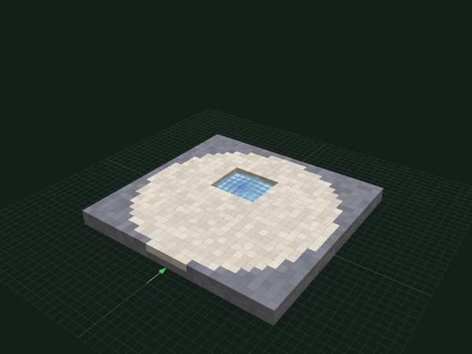
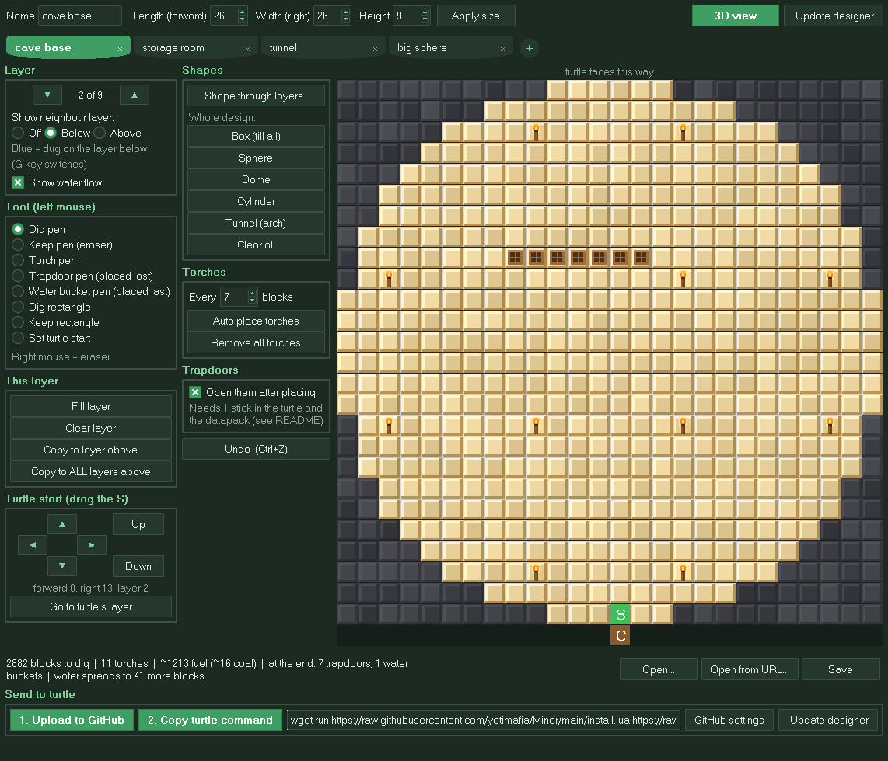
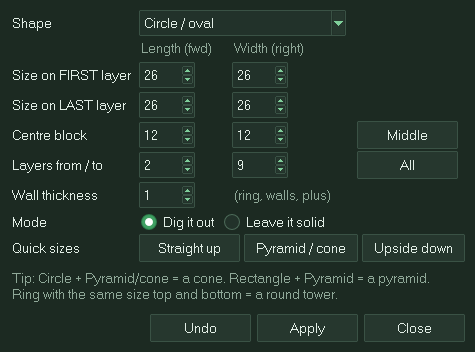
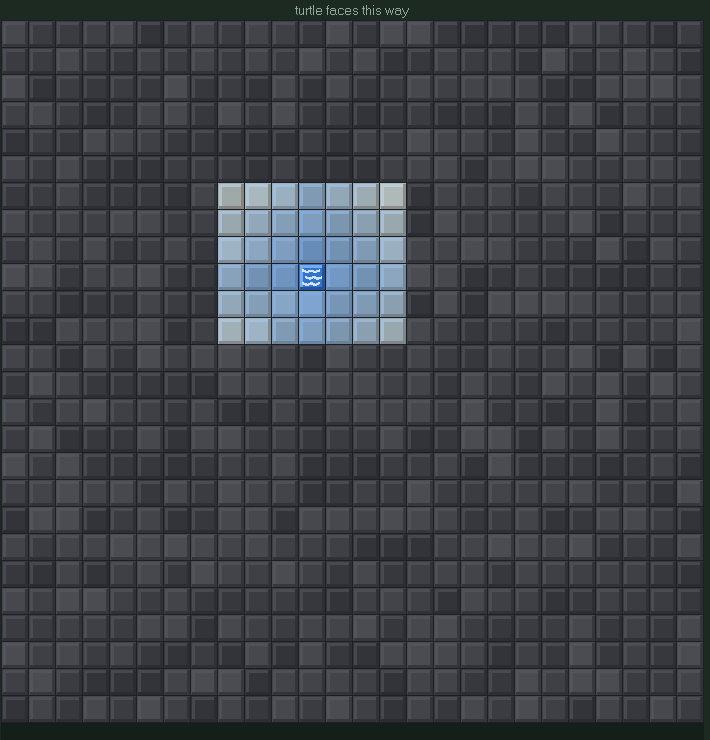
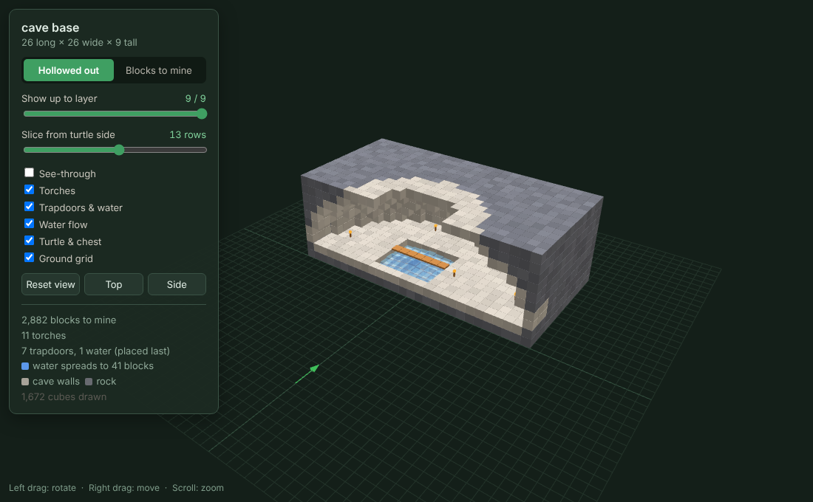
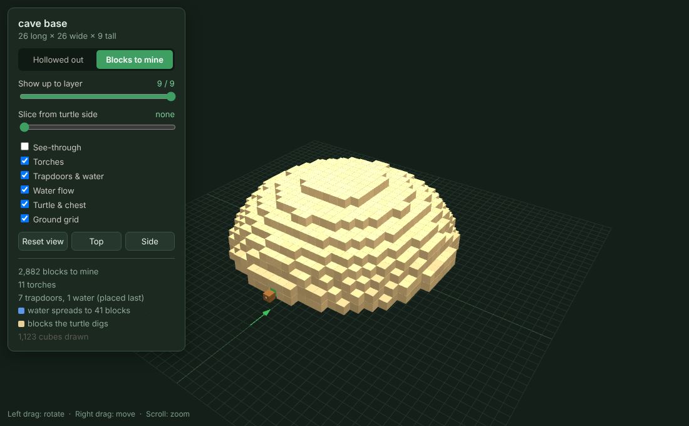

<div align="center">

# ⛏️ minor

**Design rooms on your PC, then let a ComputerCraft turtle dig them out for you.**

Draw it layer by layer, preview it in 3D, click upload, and paste one command into your turtle.<br>
It lights the room with torches, digs from the bottom up, and adds trapdoors and water at the end.




<sub>A cave base, shown layer by layer in the order the turtle digs it</sub>

</div>

---

## 🚀 Quick start

**1. Get the designer** (on your PC, needs [Python 3](https://www.python.org/downloads/))

Right-click this link and choose *Save link as*: **[designer.py](https://raw.githubusercontent.com/yetimafia/Minor/main/designer.py)**. Then double-click it, or run:

```
python designer.py
```

**2. Draw your room** and click **1. Upload to GitHub**, then **2. Copy turtle command**.

**3. Paste it into your turtle** (click the turtle's screen, press <kbd>Ctrl</kbd>+<kbd>V</kbd>, then <kbd>Enter</kbd>). It installs `minor` and starts digging, even on a brand-new turtle.

> 💡 **Just want a plain room?** You can skip the designer. On the turtle:
> ```
> wget run https://raw.githubusercontent.com/yetimafia/Minor/main/install.lua
> minor box 20 15 6
> ```

---

## 🐢 Before you press Enter

Put the turtle where the design's green **S** is, facing the way the grid points (up). For `minor box`, use the front-left-bottom corner of the room. Then:

| Put this... | Where | Why |
|---|---|---|
| 📦 **A chest** | directly **behind** the turtle | It comes back and empties its inventory here when it's full |
| 🔥 **Fuel** (coal, charcoal…) | in the turtle | It also burns coal it digs up, and comes home to ask if it runs low |
| 🕯️ **Torches** | in the turtle | Placed first, so mobs can't spawn while it works |
| 🚪 **Trapdoors** | in the turtle | Only if your design has them. Placed at the end |
| 🪣 **Water buckets** | in the turtle | One per water spot. Placed last |
| 🥢 **1 stick** | in the turtle | Only if any trapdoors are marked open (needs the [datapack](#-opening-trapdoors)) |

The turtle never burns or unloads torches, trapdoors, water buckets or sticks.

---

## 🧭 What the turtle does, in order

1. **Lights the room.** It digs a path to every torch spot and places each torch from directly above, so torches land on the floor and not the walls.
2. **Digs bottom up.** It clears layers 1–3 completely, then 4–6, and so on. It stands in the middle layer of each band, so every move clears three blocks.
3. **Places trapdoors**, and opens the ones you marked open.
4. **Places water last**, so water can't flow into spots that still need a trapdoor.
5. **Comes home**, empties into the chest, and tells you what it did.

Along the way it deals with falling gravel and sand and with mobs in the way. If it hits bedrock, it waits for you. It never digs blocks your design says to keep. The one exception: if part of your design isn't connected to the rest, it digs a small tunnel to reach it, and the designer warns you about this beforehand.

---

## 🎨 The designer



You look down on **one layer at a time**. The top of the grid is the way the turtle faces.

| Square | Means |
|---|---|
| 🟨 light sand | the turtle digs this |
| ⬛ dark stone | left alone |
| 🕯️ torch | dug, then a torch is placed on the floor |
| 🟫 hatch | dug, then a trapdoor is placed (at the end) |
| 🟫 hatch, swung up | same, then the turtle **opens** it |
| 🟦 waves | dug, then a water bucket is placed (last) |
| 🟩 **S** / 🟫 **C** | where the turtle starts / where the chest goes |

### Drawing tools

- **Pens:** dig, keep (eraser), torch, trapdoor and water. **Right-click always erases.**
- **Trapdoors, open or closed:** in the *Trapdoors* box, choose whether the trapdoor pen places them **Closed** or **Open**. The **Flip trapdoor** tool switches any trapdoor between the two with a click, and **All open** / **All closed** change every trapdoor at once.
- **Rectangles:** drag to fill or clear a box.
- **Turtle start:** drag the **S**, or use the arrow buttons. *Up*/*Down* move it between layers.
- **This layer:** fill, clear, *Copy to layer above*, or *Copy to ALL layers above*, which turns a floor plan into a room.
- **Undo** with <kbd>Ctrl</kbd>+<kbd>Z</kbd>. Change layers with the arrows or <kbd>Page Up</kbd>/<kbd>Page Down</kbd>.
- **Show neighbour layer:** see what's dug on the layer **below** (blue) or **above** (red). Press <kbd>G</kbd> to switch.

### Shapes



**Whole design:** one click for a box, sphere, dome, cylinder or arch tunnel.

**★ Shape through layers:** stamps a rectangle, circle, ring, walls, diamond or plus across a range of layers. Give it a size for the first and the last layer and it grows or shrinks in between:

- Circle shrinking to 1 = **cone**
- Rectangle shrinking to 1 = **pyramid**
- Ring, same size top and bottom = **round tower**
- *Leave it solid* = cut **pillars** out of a room

<br clear="right">

### Torches and water



- **Auto place torches** puts torches on the floor every *N* blocks. It skips spots where water will flow.
- **Show water flow** previews where each bucket will spread, using Minecraft's rules: up to 7 blocks out and shallower each block, pouring down holes and heading for nearby drops. Walls and closed trapdoors stop it.
- The bottom bar shows the block count, fuel needed (in coal), items needed, and warnings, such as water that would wash away a torch.

<br clear="right">

### Tabs that save themselves


Each tab holds its own design. **Drag** tabs to reorder them, **×** to delete, and **+** to add (up to 10). Everything **saves automatically** a couple of seconds after each change, and all your tabs come back next time you open the designer.

### 3D view

Click **3D view** (or <kbd>Ctrl</kbd>+<kbd>D</kbd>) to open your design in a Chrome tab, built with three.js r149.

<table>
<tr>
<td width="50%"></td>
<td width="50%"></td>
</tr>
<tr>
<td align="center"><b>Hollowed out</b>: rock with your room carved out, opened up so you can see inside</td>
<td align="center"><b>Blocks to mine</b>: just the blocks the turtle will dig</td>
</tr>
</table>

Slice it from the top or from the turtle's side, turn on **See-through**, and drag to spin it around. It needs internet the first time so it can load three.js.

### Sending it to the turtle

1. **1. Upload to GitHub.** The first time, it asks for a GitHub token:
   - Go to **[github.com/settings/personal-access-tokens/new](https://github.com/settings/personal-access-tokens/new)**.
   - *Repository access*: Only select repositories → your repo.
   - *Permissions → Contents*: **Read and write**.
   - Paste the token in. It's saved only on your PC, in `minor_settings.json`, which is never uploaded.
2. **2. Copy turtle command**, then paste it into the turtle.

You don't need Git installed.

### Other handy buttons

- **Open from URL…** loads a design from a link. You can paste a raw link, a github.com link or a whole turtle command, or pick from the list of designs in your repo.
- **⟳ Update designer** downloads the newest version and restarts with your work still open.
- **Open… / Save** reads and writes `.txt` design files in the `designs` folder.

---

## 🐢 Turtle commands

| Command | What it does |
|---|---|
| `minor box 20 15 6` | Dig a plain room: length (forward), width (right), height. Max 64 each |
| `minor cave-base` | Dig a design from this repo, by name |
| `minor https://…/name.txt` | Dig a design from any link |
| `minor box 20 20 5 notorch` | Add `notorch` to skip torches |
| `minor update` | Download the newest `minor` |
| `minor test` | Check the version, items, and whether trapdoor opening works |

**Example designs** to try: `cave-base` (the one in the pictures), `dome`, `tunnel`.

---

## 🚪 Opening trapdoors

Needs **CC: Tweaked 1.104 or newer** (Minecraft 1.19.4+). Out of the box, CC: Tweaked doesn't let turtles click trapdoors. To have them opened, add this tiny datapack to your world. It only adds wooden trapdoors to CC's list of blocks turtles may use.

1. Download **[minor_trapdoors.zip](datapack/minor_trapdoors.zip)**.
2. Put the zip (don't unzip it) in your world's `datapacks` folder:
   - Singleplayer: `.minecraft/saves/<your world>/datapacks/`
   - Server: `<server>/world/datapacks/`
3. Run `/reload` (or reopen the world), and give the turtle **1 stick**.

In the designer, mark each trapdoor **open** or **closed** (see *Drawing tools*). Only the ones marked open get opened. Without the datapack, the turtle notices and leaves them closed.

---

## 🛠️ Troubleshooting

<details>
<summary><b>Trapdoors don't open</b></summary>

Run **`minor test`** on the turtle with 1 trapdoor and 1 stick in it, and an empty space in front. It tells you exactly what's wrong:
- **"older than 1.104"**: your CC: Tweaked (Minecraft 1.19.2 or older) can't let turtles open trapdoors at all. They'll be placed closed.
- **"did NOT open"**: the datapack isn't loaded. Put `minor_trapdoors.zip` in the world's `datapacks` folder, run `/reload`, and check that `/datapack list` shows it as enabled.
- **"OPENED - all good!"**: opening works; make sure the trapdoors are marked *open* in the designer.
</details>

<details>
<summary><b>The turtle says "Not Found"</b></summary>

The link points at the wrong repo. In the designer, click **GitHub settings**, use **Use default repo** (or type `yetimafia/Minor`), click Save, then upload and copy the command again.
</details>

<details>
<summary><b>The turtle says HTTP is turned off</b></summary>

The server has disabled HTTP for ComputerCraft. Ask the server owner to enable `http` in the CC: Tweaked config.
</details>

<details>
<summary><b>The turtle stopped and says it's stuck</b></summary>

It hit something it can't dig, like bedrock or a protected block. Clear the way, then press any key on the turtle to continue.
</details>

<details>
<summary><b>Upload fails with 401 / 403 / 404</b></summary>

401 or 403 means the token is wrong, expired, or doesn't have **Contents: Read and write**. 404 means the repo name in **GitHub settings** is wrong, or the token can't see that repo.
</details>

<details>
<summary><b>Update designer fails on a Mac (certificate error)</b></summary>

Open *Applications → Python 3.x* and run **Install Certificates.command**, then try again.
</details>

<details>
<summary><b>A torch didn't get placed</b></summary>

Torches are always placed from directly above, so a torch spot needs open space above it and solid floor below it. In caves, open air under a spot means there's no floor. The designer warns about torches with nothing above them.
</details>

<details>
<summary><b>The water went somewhere the preview didn't show</b></summary>

The preview assumes everything outside your design is solid rock. Real caves can have openings next to your design that let water escape.
</details>

<details>
<summary><b>I lost a design I didn't save</b></summary>

Check the designer's tabs first, since they save automatically. Every upload is also kept in this repo's history on GitHub. The turtle also keeps the last design it downloaded in its `designs` folder (`ls designs`).
</details>

---

## 📁 What's in here

| File | What it is |
|---|---|
| [`designer.py`](designer.py) | The designer app for your PC (one file, needs only Python 3) |
| [`minor.lua`](minor.lua) | The turtle program |
| [`install.lua`](install.lua) | Installs or updates `minor` on a turtle, then runs your design |
| [`designs/`](designs) | Uploaded designs: the turtle downloads them from here |
| [`datapack/`](datapack) | The trapdoor datapack |
| [`docs/`](docs) | Pictures for this page |

<details>
<summary><b>Design file format</b> (for the curious)</summary>

```
minor-design 1
size <length> <width> <height>
start <x> <y> <z>
layer 0
<one line per row, run-length encoded, e.g. 3.10#1T>
```

`.` keep · `#` dig · `T` torch · `D` trapdoor · `O` open trapdoor · `W` water. `x` is forward, `z` is right, and `y` is up.
</details>
